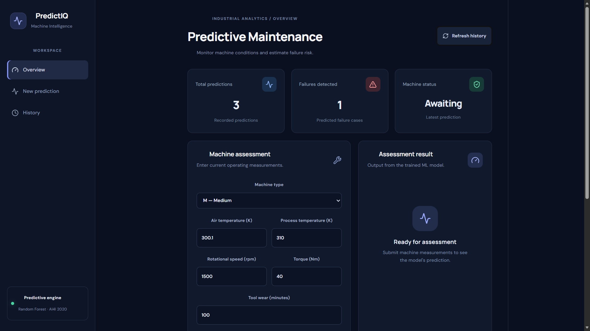
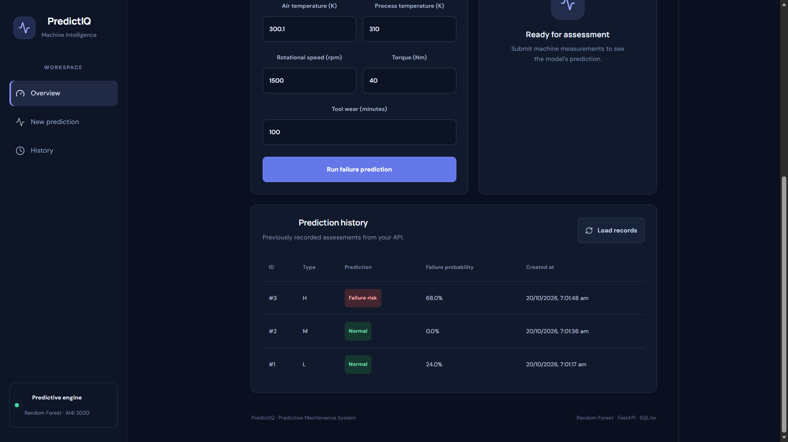

# PredictIQ — Predictive Maintenance System

An end-to-end machine learning application that estimates the probability of machine failure from equipment operating conditions. PredictIQ combines a trained Random Forest model with a FastAPI backend, a React dashboard, and a database for prediction history.

**Live Demo:** [PredictIQ Dashboard](https://predictiq-frontend-nzjy.onrender.com)  
**API Documentation:** [FastAPI Swagger UI](https://predictiq-api-a3sn.onrender.com/docs)  
**GitHub Repository:** [predictive-maintenance-ml](https://github.com/Lenin-afk/predictive-maintenance-ml)

## Features

- Trains a Random Forest classifier using the AI4I 2020 Predictive Maintenance dataset.
- Preprocesses categorical and numerical features with a scikit-learn pipeline.
- Evaluates model performance using a held-out test set and a dummy baseline.
- Exposes machine failure predictions through a REST API built with FastAPI.
- Provides a React dashboard for entering machine measurements and viewing predictions.
- Estimates failure probability and displays prediction history.
- Stores prediction records using SQLite and SQLAlchemy.
- Includes automated API tests using pytest and HTTPX.
- Supports containerization with Docker.
- Deploys the frontend and backend separately on Render.

## Dashboard Preview

### Main Dashboard


### Prediction History


## Tech Stack

| Category | Technologies |
|---|---|
| Programming | Python, JavaScript |
| Frontend | React, Vite, CSS |
| Machine Learning | pandas, scikit-learn |
| API | FastAPI, Uvicorn, Pydantic |
| Database | SQLite, SQLAlchemy |
| Testing | pytest, HTTPX |
| Environment Management | uv |
| Containerization | Docker |
| Deployment | Render |
| Version Control | Git, GitHub |

## Architecture

```text
User
 |
 v
React + Vite Dashboard
 |
 | HTTP requests
 v
FastAPI Backend
 |
 +----> Input validation
 |
 +----> Trained Random Forest Pipeline
 |              |
 |              v
 |       Failure prediction
 |       + probability estimate
 |
 +----> SQLAlchemy + SQLite
                |
                v
         Prediction history
```

The frontend sends machine measurements to the backend. FastAPI validates the input, loads the trained model to generate a prediction, and stores the prediction record. The response is then displayed in the dashboard.

## Machine Learning

### Dataset

The project uses the [AI4I 2020 Predictive Maintenance Dataset](https://archive.ics.uci.edu/dataset/601/ai4i+2020+predictive+maintenance+dataset) from the UCI Machine Learning Repository.

The dataset contains 10,000 observations representing machine operating conditions and failure outcomes.

### Input Features

The model uses six features:

- Machine type (`L`, `M`, or `H`)
- Air temperature (K)
- Process temperature (K)
- Rotational speed (rpm)
- Torque (Nm)
- Tool wear (min)

The target variable is `Machine failure`.

Identifiers and failure-mode columns are excluded from the input features to reduce data leakage.

### Model and Evaluation

The model uses a scikit-learn pipeline with categorical encoding and a Random Forest classifier. The data is split into training and test sets using stratified sampling.

Reported performance on the held-out test set:

| Metric | Result |
|---|---:|
| Accuracy | 98.15% |
| Failure-class precision | 75% |
| Failure-class recall | 68% |
| Failure-class F1-score | 71% |

Because machine failures are relatively rare in the dataset, accuracy alone is insufficient. Precision, recall, and F1-score help assess the model's ability to identify failures.

The model is a portfolio demonstration, not a certified industrial monitoring system. Predictions are estimates and should not be used as the sole basis for real-world safety or maintenance decisions.

## Live Application

### Frontend

[Open PredictIQ Dashboard](https://predictiq-frontend-nzjy.onrender.com)

The dashboard allows users to:

- Enter machine operating measurements.
- Request a machine failure prediction.
- View the predicted status and estimated failure probability.
- Review previously recorded predictions.

### Backend API

[Open API Documentation](https://predictiq-api-a3sn.onrender.com/docs)

| Method | Endpoint | Purpose |
|---|---|---|
| GET | `/` | Check API status |
| POST | `/predict` | Predict machine failure |
| GET | `/history` | Retrieve prediction history |

### Example Prediction Request

```json
{
  "Type": "L",
  "Air temperature [K]": 303.0,
  "Process temperature [K]": 313.0,
  "Rotational speed [rpm]": 1400,
  "Torque [Nm]": 55,
  "Tool wear [min]": 200
}
```

The API response includes a prediction ID, failure classification, status, and estimated failure probability.

## Run Locally

### Requirements

- Python compatible with the project configuration
- [uv](https://docs.astral.sh/uv/)
- Node.js and npm
- Docker (optional)

### 1. Clone the Repository

```powershell
git clone https://github.com/Lenin-afk/predictive-maintenance-ml.git
cd predictive-maintenance-ml
```

### 2. Install Python Dependencies

```powershell
uv sync
```

### 3. Start the Backend

From the project root:

```powershell
uv run uvicorn predictive_maintenance_ml.api:app --reload --app-dir src
```

Open the API documentation at [http://127.0.0.1:8000/docs](http://127.0.0.1:8000/docs).

### 4. Start the Frontend

Open a second PowerShell terminal:

```powershell
cd frontend
npm install
npm run dev
```

Open the local Vite URL shown in the terminal, typically [http://localhost:5173](http://localhost:5173).

For local development, the frontend uses the local API by default. The deployed frontend uses the configured `VITE_API_URL` environment variable.

## Run with Docker

Build the API image from the project root:

```powershell
docker build -t predictive-maintenance-api .
```

Run the container:

```powershell
docker run --rm -p 8000:8000 predictive-maintenance-api
```

Open [http://localhost:8000/docs](http://localhost:8000/docs).

**Storage note:** The default setup stores SQLite data locally or inside the container, depending on the environment. Container-local history is lost when the container is removed. The deployed Render free instance does not have persistent SQLite storage configured, so prediction history may be lost after restarts or redeployments.

## Run Tests

From the project root:

```powershell
uv run pytest -v
```

## Project Structure

```text
predictive-maintenance-ml/
├── data/
│   └── raw/
├── models/
│   └── predictive_maintenance.joblib
├── notebooks/
│   └── exploratory_data_analysis.ipynb
├── src/
│   └── predictive_maintenance_ml/
│       ├── api.py
│       ├── database.py
│       └── models.py
├── tests/
│   └── test_api.py
├── frontend/
│   ├── public/
│   ├── src/
│   │   ├── App.jsx
│   │   ├── App.css
│   │   ├── index.css
│   │   └── main.jsx
│   ├── index.html
│   ├── package.json
│   └── vite.config.js
├── Dockerfile
├── .dockerignore
├── pyproject.toml
├── uv.lock
└── README.md
```

## Future Improvements

- Replace ephemeral SQLite storage with a persistent database.
- Add monitoring for model performance and prediction drift.
- Improve failure detection through additional validation and model comparison.
- Add input validation and more comprehensive edge-case tests.
- Enhance dashboard visualizations and model interpretability.

---

**Disclaimer:** PredictIQ is an educational and portfolio project. Its predictions are model estimates, not guarantees of actual machine condition.